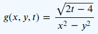

# Lab Assignment 08. Functions. Doxygen.

# Weighting factor: 7

### Objectives
The objectives of this assignment are that students:
* Are able to solve simple problems in C++ using everything learned so far,
  and in particular functions
* Design, develop and use functions in their programs, making their programs modular
* Begin to manage their lab assignments with [GitHub Classroom](https://classroom.github.com)

### Assessment rubric for this assignment
The most relevant aspects that will be taken into account when assessing this assignment are listed below (the list is not exhaustive).
It will be checked that students:
* Know the concepts presented in the reference material of this assignment.
* Have completed all the exercises proposed in this statement
* Are able to write simple C++ programs that solve problems of similar complexity to those proposed in this document
* Have automated the compilation of their programs with a `Makefile` for each of the programs they develop
* Structure their programs around different functions (modular programs)
* Know the fundamentals of code documentation
* Know the Doxygen tool and the tags defined in JSDoc, and know how to use them to document their
code
* Can prove that all the assignments completed so far are hosted in private [GitHub](https://github.com/) repositories.
* Can prove that they are able to submit programs to the [Jutge](https://jutge.org/) platform for assessment
* Have included a prologue comment in every file (`*.cc`, `*.h`) of their exercises
* Make every program they develop print, before running, a message stating the
  purpose of the program and the information it will need from the user to run correctly.
* Make every program submitted for assessment comply with the standards defined in the
[Google C++ Style Guide](https://google.github.io/styleguide/cppguide.html)
* Always use meaningful identifiers in their programs (for constants, variables, etc.) and
  never use single-letter identifiers, perhaps with the exception of loop variables.
* Can prove that they are able to edit remote files on their VM with vi
* Have completed all their exercises on the subject's Ubuntu virtual machine.
* Show that they are able to run Linux commands on their VM

### Doxygen
[Doxygen](https://en.wikipedia.org/wiki/Doxygen)
is an open-source tool that generates reference documentation for software development projects.
One advantage of Doxygen is that the documentation is written in the source code itself, which makes it relatively easy to keep up to date.
Doxygen can cross-reference documentation and code, so that the reader of a document can easily refer to the source code.
The tool extracts the documentation from the comments in the source files and can produce output in several formats, including HTML, PDF, LaTeX and Unix `man` pages.

*Informática Básica* does not propose an exhaustive use of Doxygen, but **it does require the
documentation of the programs developed to be written in the format recognised by Doxygen**, which has
become a de facto standard.

Start by installing Doxygen on the subject's virtual machine:
```
$ sudo apt install doxygen
```
Also install the packages `texlive-latex-base`, `texlive-latex-recommended` and `texlive-latex-extra`:
```
$ sudo apt install texlive-latex-base
$ sudo apt install texlive-latex-recommended
$ sudo apt install texlive-latex-extra
```
These packages are needed to compile files in [LaTeX](https://es.wikipedia.org/wiki/LaTeX) format.
The need for the programs these packages provide is explained later in this document.

The [Doxygen manual](https://www.doxygen.nl/manual/starting.html) explains how to start working with the tool.
If, from a working folder, you run:
```
doxygen -g <config-file>
```
the tool creates a configuration file.
If no file name (*config-file*) is passed as a parameter, it creates a file named `Doxyfile`, preconfigured for use.
The working folder of this assignment (`src`) contains a `Doxyfile` ready to use with C++ projects.
That folder also contains the source code of a program that illustrates documentation with Doxygen.
If you look at the `Doxyfile` (a text file), you will see a set of options the program supports.
Each option is preceded by an explanation of its purpose and behaviour, so you can try changing some of them if you wish.
[This page](https://www.doxygen.nl/manual/config.html) describes the purpose and behaviour of each tag used in the Doxygen configuration file.

To generate the documentation of your application, go to your project folder (`src` in this assignment) and run:
```
doxygen Doxyfile
```
With the supplied `Doxyfile`, the tool creates a `doc` subfolder in the root folder
of your project and places all the generated documentation there.
The folder where Doxygen writes its output is set with the `OUTPUT_DIRECTORY` tag
(line `61` of the supplied `Doxyfile`).
With the supplied configuration, two subfolders are created inside `doc`: `html` and `latex`.
If you go to `doc/latex/` and run `make`, the system "compiles" the LaTeX code and
generates a file `refman.pdf` with the generated documentation.
Note that here `make` and a `Makefile` are used not to compile a program but to generate
a `pdf` file from LaTeX code (text).
If you work on your virtual machine, copy `refman.pdf` to your local machine and view its
contents.

If you open `doc/html/index.html` in a browser, you will reach the main page of the documentation generated for the program.
You will not be able to open a browser on your virtual machine to explore the files in `doc/html`.
Instead, either generate them on your local Linux installation or copy the contents of the `doc` folder from
your IaaS virtual machine to your local machine and open `doc/html/index.html` there in a browser.

As mentioned, HTML and LaTeX are only two of the formats Doxygen can generate.
Both HTML and LaTeX (and also
[Markdown](https://es.wikipedia.org/wiki/Markdown))
are what are known as
[markup languages](https://es.wikipedia.org/wiki/Lenguaje_de_marcado).
HTML is the language used to compose the text shown on web pages.
[LaTeX](https://en.wikipedia.org/wiki/LaTeX)
is a typesetting system that pays particular attention to formatting, especially typography, and is particularly suited to scientific texts.
You are not expected to study HTML or LaTeX in depth here.

The section [Documenting the code](https://www.doxygen.nl/manual/docblocks.html)
of the Doxygen manual explains how to comment source code so that Doxygen processes the comments and includes them in the generated documentation.

The code documentation guide [Documenting C++ Code](https://developer.lsst.io/cpp/api-docs.html) of the LSST project is the reference adopted in the subject for documenting the code of the programs developed.
JavaDoc-style comments will be used for block comments:
```
/**
 * ... text comment ...
 */
```
[JavaDoc](https://en.wikipedia.org/wiki/Javadoc) is another documentation system, designed for Java, that is also very popular.
Doxygen supports "Javadoc-style" tags in code.

Multi-line comment blocks must start with
```
/**
```
and end with
```
*/
```
Single-line comments must start with `///`.
For consistency, do not use the options

```
/*!
```
or
```
//!
```
allowed by Doxygen.

Thus, the
[comment block](https://jsdoc.app/tags-description.html)
that must precede any function (or method) should look similar to this:
```
/**
 * Sum numbers in a vector
 *
 * @param values Container whose values are summed
 * @return sum of `values`, or 0.0 if `values` is empty
 */
double SumValues(const std::vector<double>& values) {
  ...
}
```
In the previous example, `@param` and `@return` are Javadoc-style tags.
These tags are described in
[Overview of supported JavaDoc style tags](http://www.time2help.com/doc/online_help/idh_java_doc_tag_support.htm).

The following is an example (template) of the block comment that should be included at the start of every file (`*.cc`, `*.h`) of a programming project in this subject:
``` .cpp
/**
  * Universidad de La Laguna
  * Escuela Superior de Ingeniería y Tecnología
  * Bachelor's Degree in Computer Engineering
  * Informática Básica 2022-2023
  *
  * @author Albert Einstein aeinstein@ull.edu.es
  * @date Oct 12 2022
  * @brief The program computes the sum of all even-valued terms of the Fibonacci
  *        sequence that are less than a given value.
  *        Each new term of the sequence is the sum of the previous two.
  *        Starting with 0 and 1, the first 10 terms are: 0, 1, 1, 2, 3, 5, 8, 13, 21, 34
  * @bug There are no known bugs
  * @see https://www.cs.cmu.edu/~410/doc/doxygen.html
  */
```
Every file should contain (`@brief` tag) a short description of its contents.
If needed, a more detailed description follows.
Obviously, the comment should be tailored to each specific case.

### Complementary study material
Study everything in the section
[Functions](https://google.github.io/styleguide/cppguide.html#Functions)
of the Google Style Guide and put into practice everything it proposes.
You may find content in that section that you have not studied yet: do not worry.
Focus on the aspects you already know, to consolidate them.

Study the following sections of the subject's
[reference tutorial](https://www.learncpp.com/):
* [Local variables](https://www.learncpp.com/cpp-tutorial/local-variables/)
* [Introduction to global variables](https://www.learncpp.com/cpp-tutorial/introduction-to-global-variables/)
* [Variable shadowing (name hiding)](https://www.learncpp.com/cpp-tutorial/variable-shadowing-name-hiding/)
* [Scope, duration, and linkage summary](https://www.learncpp.com/cpp-tutorial/scope-duration-and-linkage-summary/)
* [Command line arguments](https://www.learncpp.com/cpp-tutorial/command-line-arguments/)

### Exercises
* When doing the exercises, create inside your repository for this assignment a separate folder
for each exercise.
Give each folder a meaningful name.
* Automate the compilation of each exercise's program with a separate `Makefile`
for each program, and place it in the corresponding folder.
* Make every program take its input from the command line and, if it is run without
  the right number of parameters, print a message stating the correct way to
  run the program.
* The code of each program must be modular, that is, it must use functions
* Each function must perform a single task and do it correctly
* The identifier of a function must clearly reflect what the function does

1. Write a program `function-example.cc` that includes a C++ function computing
the following mathematical function of three variables:



```
Public test cases
Input           Output
3 4 5           -0.349927
4.0 1.0 7.0      0.210819
1 2 3           -0.471405
3 2 10.0         0.8
```

2. Write a program `change-case.cc` that takes as input a string with no spaces and prints the
same string, converting uppercase letters to lowercase and vice versa.
Characters that are neither uppercase nor lowercase letters must remain unchanged.
Write your program so that it includes at least two functions, and design it so that the program
is split into more than one source file (`*.cc`).

```
Public test cases
Input           Output
Abecedario      aBECEDARIO
PyThon          pYtHON
AlFa2022        aLfA2022
```

3. Write a program `random_numbers.cc` that takes as input two natural numbers `n` and `m` such that `n < m` and generates
a random real number `r` in the interval `[n, m]`.

Write your program so that it includes at least two functions, one of which takes as
parameters the two numbers entered by the user and returns the random number.

To generate random numbers in C++, see the function `std::rand`, for example in
[this reference](https://en.cppreference.com/w/cpp/numeric/random/rand).

Write a program `random_numbers.cc` that takes as input two natural numbers `n` and `m` such that n < m and generates a random real number r in the interval [n, m]. To generate random numbers in C++, see the function std::rand, for example in this reference.

4. Study the program
[`floating-point-arithmetics.cc`](https://github.com/IB-2024-2025/P08-functions/blob/main/floating-point-arithmetics.cc)
included in the root folder of this assignment's repository.
That program defines a constant of type double, `kOneThird`, whose value (0.333) should match that of
the fraction 1/3.
If both values are printed separately, they seem equal; however, if the expression
`1.0 / 3 == kOneThird` is used in a conditional statement, it turns out to be false.
This behaviour is due to the imprecision introduced by the floating-point representation of numbers
in a computer.
To study this phenomenon further, read the article
[Problem in comparing Floating point numbers and how to compare them correctly?](https://www.geeksforgeeks.org/problem-in-comparing-floating-point-numbers-and-how-to-compare-them-correctly/)

Then write a function whose definition is:
`bool AreEqual(const double number1, const double number2, const double epsilon = 1e-7);`
that returns `true` or `false` depending on whether the numbers passed as parameters are approximately
equal.
The third parameter, `1e-7` by default, is a very small value that the function uses as
the margin of error when deciding whether the numbers are equal.
[This article](https://www.tutorialspoint.com/floating-point-comparison-in-cplusplus)
from *Tutorials Point* or
[this
entry](https://stackoverflow.com/questions/17333/what-is-the-most-effective-way-for-float-and-double-comparison/253874#253874)
on *StackOverflow* may help you write the function.

Test the behaviour of your function with different pairs of input values.

5. Write a program `triangle-area.cc` that takes as input the lengths `a`, `b` and `c` of the sides of
a triangle and computes its area using
[Heron's formula](https://en.wikipedia.org/wiki/Heron%27s_formula).
Design a function named *Area* that implements that calculation.

The three sides of the triangle, `a`, `b`, `c`, must satisfy the triangle inequality:
no side can be longer than the sum of the other two.
Design a function *IsAValidTriangle* that determines whether the sides entered by the user form a
valid triangle, and compute its area only if it is valid

```
Public test cases
Input           Output
5 5 5            10.82
3 4 6             5.33
3.9 6.0 1.2      Not a valid Triangle
1.9 2 2           1.67
```
